# 16types-crest

Original flag-style crests for the 16 four-letter personality types, made to drop into a GitHub profile README.

<p align="center">
  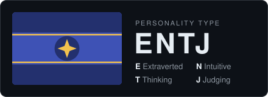
</p>

## Usage

Pick your type, then copy one of the snippets below into your README. Replace `entj` with your own four letters in lowercase.

### Card

```md

```

For light backgrounds, add `-light`:

```md

```

### Badge


```md

```

### Flag only

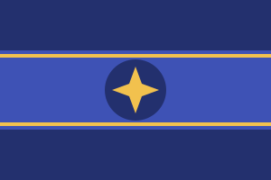

```md

```

## Gallery

| | | | | |
|---|---|---|---|---|
| **NT** | 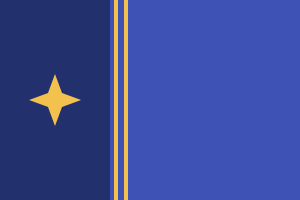<br><code>intj</code> | 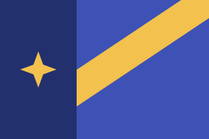<br><code>intp</code> | <br><code>entj</code> | 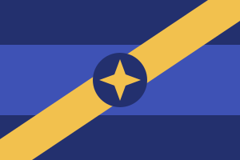<br><code>entp</code> |
| **NF** | 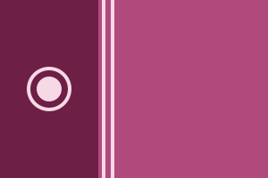<br><code>infj</code> | 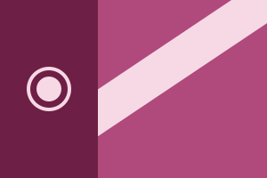<br><code>infp</code> | 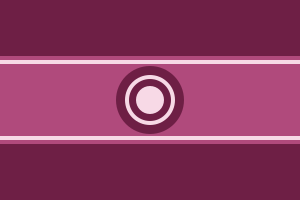<br><code>enfj</code> | 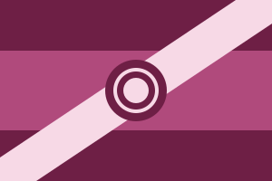<br><code>enfp</code> |
| **SJ** | 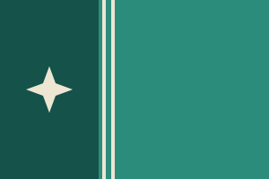<br><code>istj</code> | 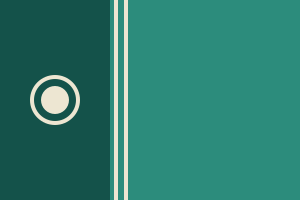<br><code>isfj</code> | 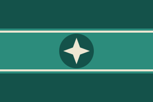<br><code>estj</code> | 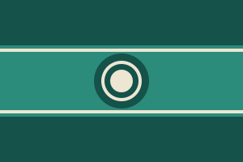<br><code>esfj</code> |
| **SP** | 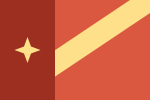<br><code>istp</code> | <br><code>isfp</code> | 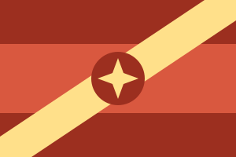<br><code>estp</code> | 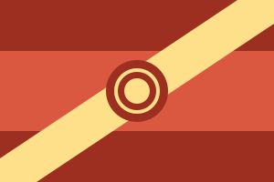<br><code>esfp</code> |

## How the flags work

Every flag is built from the four letters, so no two types share a flag.

| Letter | Element | |
|---|---|---|
| E / I | Layout | E: horizontal triband. I: vertical hoist bar. |
| N / S | Colour | NT: navy and gold. NF: plum and blush. SJ: teal and cream. SP: vermilion and yellow. |
| T / F | Emblem | T: four-point star. F: sun disc with a ring. |
| J / P | Pattern | J: straight pinstripes. P: diagonal sash. |

## Building

The SVGs in `dist/` are generated. To change a design, edit `build.mjs` and run:

```sh
node build.mjs
```

No dependencies are needed. Commit the regenerated `dist/` together with your change.

## Contributing

Issues and pull requests are welcome, for example new styles, themes, or design fixes.

## Disclaimer

This project is not affiliated with, endorsed by, or connected to 16Personalities (NERIS Analytics Limited), The Myers-Briggs Company, or any other personality assessment provider. All flag designs are original. The four-letter codes and the single trait words are used only to describe each type.

## License

[MIT](LICENSE)
