# 16types-crest

A seamless line pattern made from your four-letter personality type and your birthday. Every type and every day of the year gives a different pattern, 5,856 in total.

<p align="center">
  
  
  
  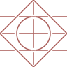
</p>

## Usage

Use the four letters you got from a test such as 16Personalities, and your birthday as month and day (`MMDD`).

```
https://takakimoriguchi.github.io/16types-crest/{type}/{MMDD}.svg
```

For example, ENTJ born on 13 April:

```md

```

The image is one tile that repeats without seams, so it also works as a background:

```css
background: url(https://takakimoriguchi.github.io/16types-crest/entj/0413.svg) repeat;
```

You can also pick your type and birthday on the [pattern page](https://takakimoriguchi.github.io/16types-crest/) and copy the snippet from there.

> The URL is public. Anyone who reads your README can see the month and day in it. The year is never used.

## How the shapes work

Each pair of letters draws one layer of thin lines. The four layers are stacked into one 100 x 100 tile.

<table>
  <tr>
    <th>Letters</th>
    <th colspan="2">Shape</th>
    <th>Rule</th>
    <th>Why</th>
  </tr>
  <tr>
    <td><b>N / S</b></td>
    <td align="center"><br><b>N</b></td>
    <td align="center">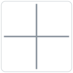<br><b>S</b></td>
    <td>Cross through the centre.<br>N: diagonal ×<br>S: upright +</td>
    <td>Intuitive leaves the vertical and horizontal grid and jumps across it. Observant stays on the real-world axes, grounded in what can be seen.</td>
  </tr>
  <tr>
    <td><b>T / F</b></td>
    <td align="center">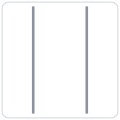<br><b>T</b></td>
    <td align="center">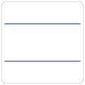<br><b>F</b></td>
    <td>Two lines.<br>T: vertical<br>F: horizontal</td>
    <td>Thinking builds a vertical line of reasoning, one step on top of another. Feeling spreads sideways, as connection between people.</td>
  </tr>
  <tr>
    <td><b>E / I</b></td>
    <td align="center">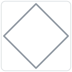<br><b>E</b></td>
    <td align="center">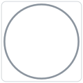<br><b>I</b></td>
    <td>Outer shape.<br>E: diamond<br>I: circle</td>
    <td>The four corners of the diamond point outward, like energy going out. The circle is closed and complete in itself, like energy kept inside.</td>
  </tr>
  <tr>
    <td><b>J / P</b></td>
    <td align="center">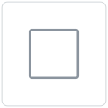<br><b>J</b></td>
    <td align="center">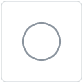<br><b>P</b></td>
    <td>Centre shape.<br>J: square<br>P: circle</td>
    <td>Straight edges and corners make clear boundaries, like a plan. A circle has no corners and can turn any way, like an open, flexible approach.</td>
  </tr>
</table>

### Weaving

The layers are woven. Where an upper layer crosses a lower one, the lower line gets a short gap, so it looks like it passes underneath. From bottom to top the order is T / F, N / S, E / I, J / P. The row below shows each layer of ENTJ on its own, in the order of the letters.

<table>
  <tr>
    <td align="center">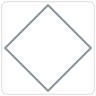<br>E</td>
    <td align="center">+</td>
    <td align="center"><br>N</td>
    <td align="center">+</td>
    <td align="center"><br>T</td>
    <td align="center">+</td>
    <td align="center">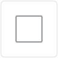<br>J</td>
    <td align="center">=</td>
    <td align="center">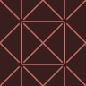<br>ENTJ</td>
  </tr>
</table>

## How the colour works

The colour comes from where the Sun is on your birthday.

| | Rule | Why |
|---|---|---|
| Hue | The Sun's ecliptic longitude on that day, used directly as the hue angle | Over one year the Sun moves once around the ecliptic, 0° to 360°, just as hue goes once around the colour wheel. Every day gets its own colour. |
| Lightness and chroma | The most vivid colour of that hue that a screen can show, with lightness kept between 0.50 and 0.75 | Every day gets its colour at full strength. The lightness range keeps the lines visible on both light and dark pages. |
| Background | None, only the lines are drawn | The pattern sits on any background. |
| Colour space | OKLCH | Lightness and vividness are measured the way the eye sees them, so the most vivid point of each hue can be found fairly. |

<p align="center">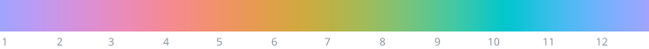</p>

| Day | Sun's longitude | Hue |
|---|---|---|
| March equinox (about 20 March) | 0° | red-pink |
| June solstice (about 21 June) | 90° | yellow |
| September equinox (about 22 September) | 180° | green-cyan |
| December solstice (about 21 December) | 270° | blue |

ENTJ through the year:

<p align="center">
  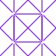
  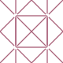
  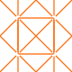
  
  
  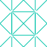
  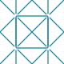
  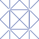
</p>

The longitude is computed with the low-precision formula from the Astronomical Almanac, for each day at 12:00 UTC in the year 2000. 2000 is a leap year, so 29 February is included.

## All 16 types

On 13 April:

| | | | |
|---|---|---|---|
| <br><code>intj</code> | <br><code>intp</code> | <br><code>entj</code> | 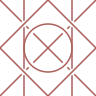<br><code>entp</code> |
| <br><code>infj</code> | <br><code>infp</code> | 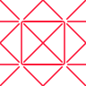<br><code>enfj</code> | <br><code>enfp</code> |
| <br><code>istj</code> | 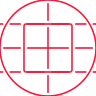<br><code>isfj</code> | 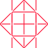<br><code>estj</code> | <br><code>esfj</code> |
| <br><code>istp</code> | 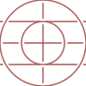<br><code>isfp</code> | 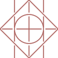<br><code>estp</code> | <br><code>esfp</code> |

## Building

No dependencies are needed.

```sh
node build.mjs          # all 5,856 patterns into dist/
node docs/figures.mjs   # the figures in this README
node --test test/*.test.mjs
```

`dist/` is not committed. On every push to `main`, GitHub Actions builds it and publishes it to GitHub Pages.

## Contributing

Issues and pull requests are welcome.

## Support

If you like this project, you can [buy me a beer](https://buymeacoffee.com/takakimoriguchi).

## Disclaimer

This project is not affiliated with, endorsed by, or connected to 16Personalities (NERIS Analytics Limited), The Myers-Briggs Company, or any other personality assessment provider. All designs are original. The four-letter codes and the single trait words are used only to describe each type.

## License

[MIT](LICENSE)
